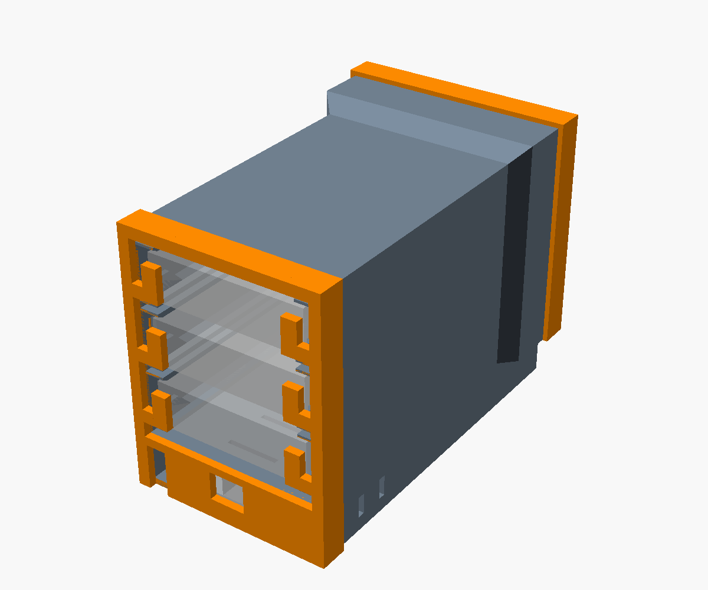
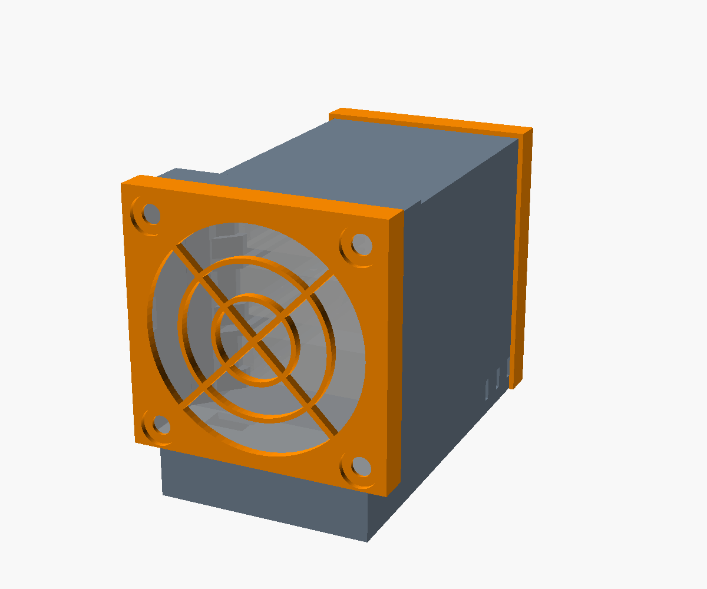

# ASIC Timelord Enclosure

A 3D-printed enclosure that holds three ASIC timelord units, with an 80 mm fan and a built-in 12 V-to-5 V power board. One 12 V brick powers everything, and the fan and power cables stay inside.

 

## Parts

| Part | Link |
|---|---|
| Noctua NF-A8 5V PWM fan (includes USB-A adapter and NA-AV1 rubber mounts) | [Amazon](https://www.amazon.com/dp/B07DXMF32M) |
| Dual USB QC3.0 DC-DC buck board, 6–32 V in, 5 V out, 50 × 40 mm | [Amazon](https://www.amazon.com/dp/B0B5D8B83Z) / [AliExpress](https://www.aliexpress.us/item/3256806574043074.html) |
| 12 V 3 A power brick, 5.5 × 2.1 mm plug | [Amazon](https://www.amazon.com/dp/B095XD1TD2) |
| USB-A to 3 × USB-C splitter, 20 cm | [Amazon](https://www.amazon.com/dp/B09WRBK8HD) |
| Optional: 6 in USB-A extension, for more slack on the splitter | [Amazon](https://www.amazon.com/dp/B00CJG2ZYM) |

## Printing

Print `tube`, `front_frame` and `back_frame` from [`stl/`](stl/). They're already oriented, so no supports are needed.

- **Material:** PETG or ASA. Don't use PLA, because the units get warm enough to soften it.
- **Settings:** 0.2 mm layers, 6 walls, 15% infill. Use a brim on the tube.

To change a dimension, edit [`asic_enclosure.scad`](asic_enclosure.scad) and export again:

```bash
openscad --backend=manifold -o stl/tube.stl -D 'part="tube"' asic_enclosure.scad
```

## Assembly

1. **Fan:** push the four rubber mounts into the front frame from the outside. Pull them through the fan's corner holes, with the fan's label facing away from the frame, so it blows into the enclosure. Slide the fan into the front pocket and feed its cable down through the hole in the pocket floor. Then snap the frame on.
2. **Power board:** plug the fan into one USB-A port and the splitter into the other, through the extension if you're using one. From the back, slide the board into the bay under the units, barrel jack facing you, until it stops.
3. **Units:** slide each unit in from the back, ports facing out.
4. **Back frame:** guide the splitter's leads into the notch at the bottom, then snap the frame on.
5. **Cables:** plug a splitter lead into each unit's power port (the left port as seen from the back). Then connect the host ports and the 12 V brick.

To take it apart, flex the side snaps outward and pull the back frame off.

See [DESIGN.md](DESIGN.md) for how the airflow and fit work.

## License

[CC BY 4.0](LICENSE). Free to use, change and share, with attribution.
